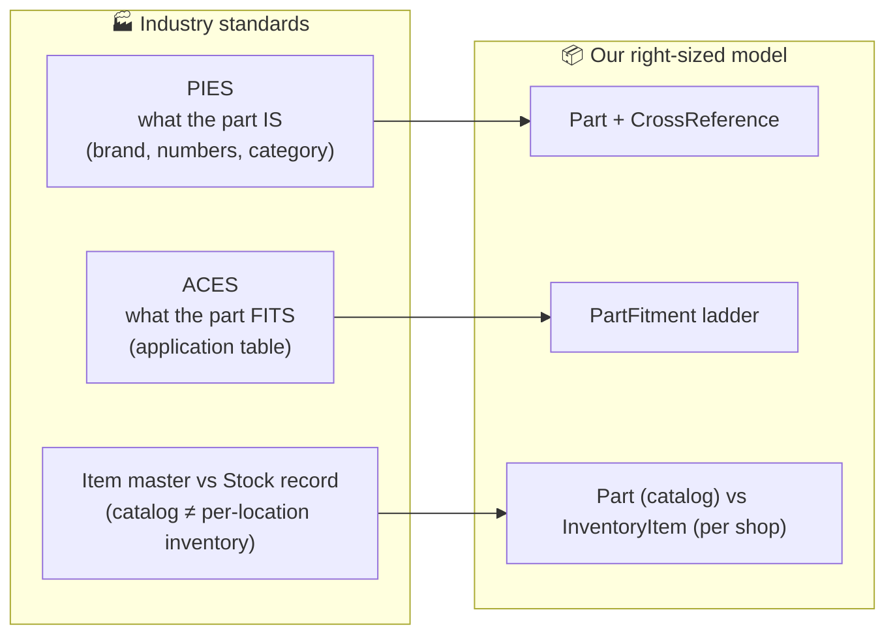
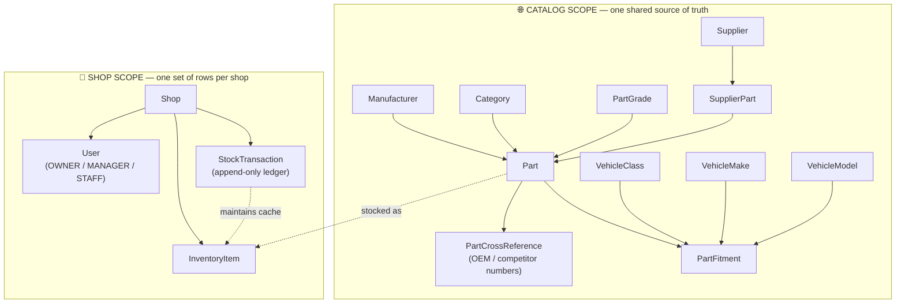
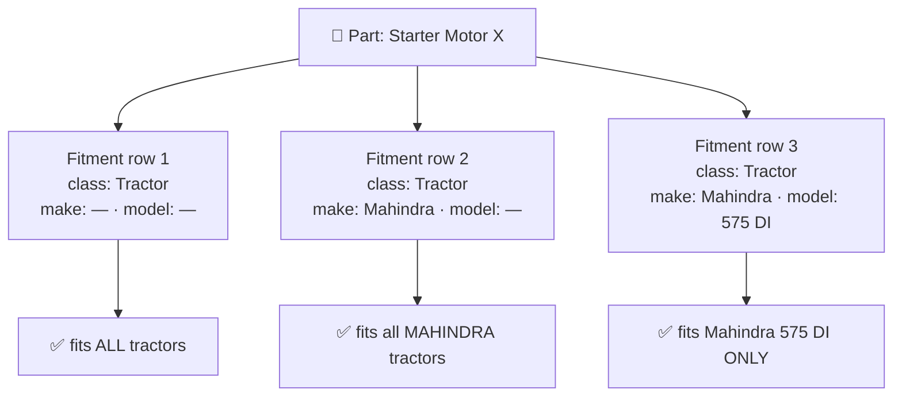
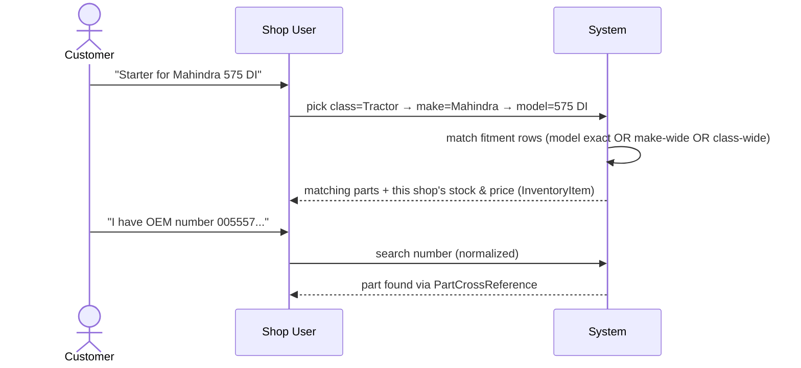
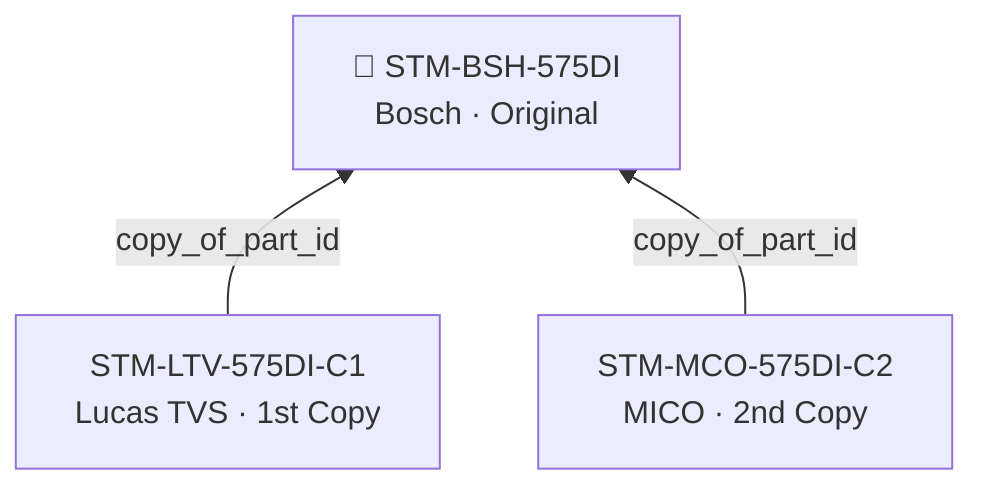
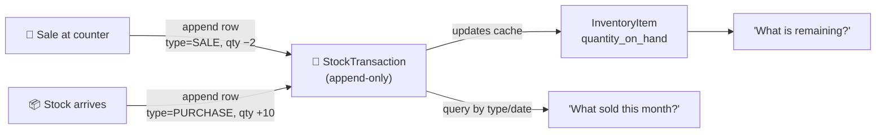
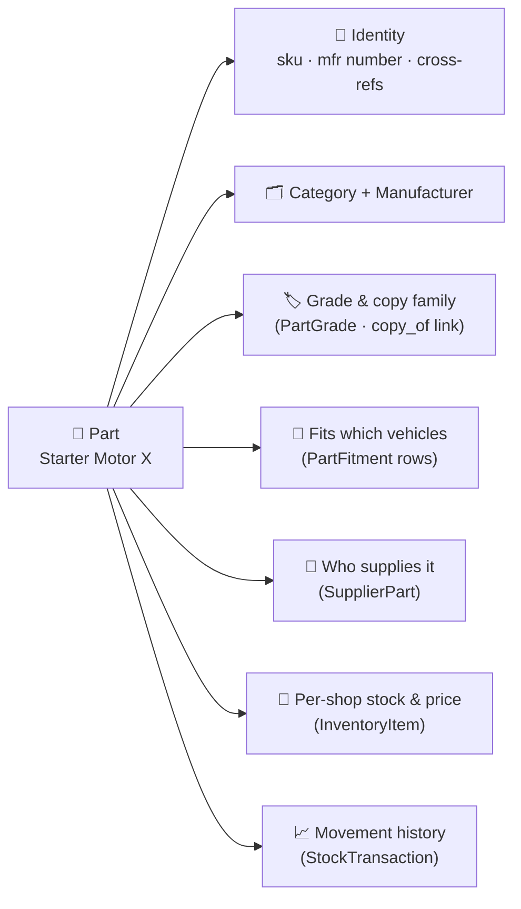

# Domain Model

## 1. Introduction

This document defines the domain model for a multi-shop management system. The first use case is a vehicle spare-parts shop: a business that stocks parts across one or more physical locations, sources them from multiple suppliers, and needs to match a part to the vehicles it fits. This model is the canonical design reference for the database schema and API that implement it.

## 2. How the industry models this

The auto-care industry has already solved most of this problem. The Auto Care Association maintains two data standards that every serious parts catalog is built on: PIES and ACES.

PIES (the product information standard) describes what a part **IS**: its brand, part number, category, and — critically — its cross-reference or interchange numbers, so the same physical part can be found under an OEM number or a competitor's number.

ACES (the fitment standard) describes what a part **FITS**: an application table that maps a part to entries in a shared vehicle database, at whatever granularity the data supports — sometimes down to year and engine, sometimes only down to a vehicle class.

Underneath both standards sits one structural decision that every serious inventory system makes: separate the **item master** (the catalog — what a part IS) from the **stock record** (per-location quantity and price). This is the single most important split in this domain model. A part's identity doesn't change from shop to shop; its stock level and price do.

The standards also keep two roles apart that are easy to conflate: **Manufacturer** and **Supplier**. Bosch makes the part. A local distributor sells it to the shop. They are rarely the same company, and the model needs both.

The model in this document is a right-sized version of ACES/PIES, scoped to what a small multi-shop spare-parts business needs today. Two deliberate simplifications: no year/engine-level fitment granularity, and Brand and Manufacturer are collapsed into a single entity.



## 3. The big picture — two scopes

Every entity in this model lives in one of two scopes.

**Catalog scope** is shared across all shops: Manufacturer, Category (a self-referential tree), PartGrade, Part, PartCrossReference, VehicleClass, VehicleMake, VehicleModel, PartFitment, Supplier, and SupplierPart. There is one copy of this data no matter how many shops use the system.

**Shop scope** covers Shop itself, plus everything whose rows reference it: User, InventoryItem, and StockTransaction.



Two judgment calls shaped this split:

**Supplier is catalog-scope, not shop-scope.** A multi-shop owner typically buys from the same distributors across all their shops, so keeping Supplier shared avoids duplicate data entry. Per-shop supplier preferences can be layered on later without restructuring the model.

**User is shop-scope, for now.** Today a user belongs to exactly one shop. An owner who operates several shops is a real scenario, but it's handled later by lifting User into a shared entity plus a `UserShopRole` join table — a mechanical migration, not a redesign. Building that join now would be speculative; YAGNI applies.

## 4. Full ER diagram

```mermaid
erDiagram
    MANUFACTURER {
        int id PK
        string name "unique — Bosch, Lucas TVS"
        string code "short abbrev, e.g. BOS"
    }
    CATEGORY {
        int id PK
        string name
        int parent_category_id FK "nullable, self-ref tree"
    }
    PART_GRADE {
        int id PK
        string name "unique — Original, 1st Copy, 2nd Copy"
        int display_order "rank — lower is closer to original"
        bool is_active "soft retire — user-addable table"
    }
    PART {
        int id PK
        string sku "internal number, unique"
        int manufacturer_id FK
        string manufacturer_part_number "unique per manufacturer"
        string name
        int category_id FK
        int grade_id FK "nullable — quality tier"
        int copy_of_part_id FK "nullable, self-ref — its original"
        string unit_of_measure "default piece"
        decimal mrp "nullable — printed on box"
        bool is_active
    }
    PART_CROSS_REFERENCE {
        int id PK
        int part_id FK
        string ref_type "OEM|COMPETITOR|SUPERSEDES|ALTERNATE"
        string ref_number
        string ref_brand "free text"
    }
    VEHICLE_CLASS {
        int id PK
        string name "Tractor, Passenger, 2-Wheeler — user-addable"
    }
    VEHICLE_MAKE {
        int id PK
        string name "global — Mahindra, Ford, Hero"
    }
    VEHICLE_MODEL {
        int id PK
        int vehicle_make_id FK
        int vehicle_class_id FK
        string name "575 DI — unique per (make, class)"
    }
    PART_FITMENT {
        int id PK
        int part_id FK
        int vehicle_class_id FK "required"
        int vehicle_make_id FK "nullable"
        int vehicle_model_id FK "nullable"
        string notes "e.g. front axle only"
    }
    SUPPLIER {
        int id PK
        string name
        string contact_person
        string phone
        string gstin
    }
    SUPPLIER_PART {
        int id PK
        int supplier_id FK
        int part_id FK
        string supplier_part_number "nullable"
        bool is_preferred
    }
    SHOP {
        int id PK
        string name
        string address
        string gstin
    }
    USER {
        int id PK
        int shop_id FK
        string name
        string phone
        string role "OWNER|MANAGER|STAFF"
    }
    INVENTORY_ITEM {
        int id PK
        int shop_id FK
        int part_id FK "unique per (shop, part)"
        decimal quantity_on_hand "cache, maintained by ledger"
        decimal reorder_level
        decimal cost_price "per shop"
        decimal selling_price "per shop"
        string storage_location "rack/bin, e.g. R3-B2"
    }
    STOCK_TRANSACTION {
        int id PK
        int shop_id FK
        int part_id FK
        int user_id FK "who recorded it"
        string type "SALE|PURCHASE|ADJUSTMENT"
        decimal quantity "+in / -out"
        decimal unit_price "nullable — price at transaction time"
        string notes
        datetime created_at
    }

    MANUFACTURER ||--o{ PART : "makes"
    CATEGORY ||--o{ CATEGORY : "parent of"
    CATEGORY ||--o{ PART : "groups"
    PART_GRADE |o--o{ PART : "tiers (optional)"
    PART |o--o{ PART : "copied as (optional)"
    PART ||--o{ PART_CROSS_REFERENCE : "known by"
    PART ||--o{ PART_FITMENT : "has applications"
    VEHICLE_CLASS ||--o{ VEHICLE_MODEL : "classifies"
    VEHICLE_MAKE ||--o{ VEHICLE_MODEL : "offers"
    VEHICLE_CLASS ||--o{ PART_FITMENT : "scopes (required)"
    VEHICLE_MAKE |o--o{ PART_FITMENT : "narrows (optional)"
    VEHICLE_MODEL |o--o{ PART_FITMENT : "pinpoints (optional)"
    SUPPLIER ||--o{ SUPPLIER_PART : "lists"
    PART ||--o{ SUPPLIER_PART : "sourced via"
    SHOP ||--o{ USER : "employs"
    SHOP ||--o{ INVENTORY_ITEM : "stocks"
    PART ||--o{ INVENTORY_ITEM : "stocked as"
    SHOP ||--o{ STOCK_TRANSACTION : "records"
    PART ||--o{ STOCK_TRANSACTION : "moved in"
    USER ||--o{ STOCK_TRANSACTION : "recorded by"
```



## 5. Entity catalog

Cardinality below reads as "one … to many …" unless noted otherwise.

#### Manufacturer

Purpose: the company that physically makes a part — e.g. Bosch, Lucas TVS.

Key attributes:
- `name` — unique
- `code` — short abbreviation (e.g. BOS)

Relationships:
- One Manufacturer makes many Parts.

#### Category

Purpose: groups parts into a browsable classification (e.g. Electrical, Suspension, Filters).

Key attributes:
- `name`
- `parent_category_id` — nullable, self-referential

Relationships:
- One Category is the parent of many child Categories (self-referential tree).
- One Category groups many Parts.

#### PartGrade

Purpose: a quality tier a part is sold as — Original, 1st Copy, 2nd Copy. See section 7 for the full design.

Key attributes:
- `name` — unique
- `display_order` — rank; lower is closer to the original
- `is_active` — soft retire

Notes: like VehicleClass, PartGrade is a plain, user-addable table, not an enum — the grade vocabulary varies by trade and grows in the field. Deleting a grade only sets `is_active` false: it disappears from pickers, but parts already tagged with it keep the tag, and the RESTRICT foreign key from Part blocks a hard delete while any part still references it.

Relationships:
- One PartGrade optionally tiers many Parts.

#### Part

Purpose: the catalog record for a part — what it IS, independent of any shop's stock.

Key attributes:
- `sku` — internal number, unique
- `manufacturer_id`
- `manufacturer_part_number` — unique per manufacturer
- `name`
- `category_id`
- `grade_id` — nullable
- `copy_of_part_id` — nullable, self-referential
- `unit_of_measure` — default piece
- `mrp` — nullable
- `is_active`

Notes: Part is catalog-only — it carries no quantity. `mrp` lives on Part rather than on a per-shop record because it's printed on the box and is the same everywhere. The pair `(manufacturer_id, manufacturer_part_number)` is unique. `grade_id` tags the part's quality tier and `copy_of_part_id` links a copy to its original — both nullable, both independent of each other; see section 7.

Relationships:
- One Manufacturer makes many Parts.
- One Category groups many Parts.
- One PartGrade optionally tiers many Parts.
- One Part (an original) is copied as many Parts (self-referential, one level deep).
- One Part is known by many PartCrossReference rows.
- One Part has many PartFitment rows (applications).
- One Part is sourced via many SupplierPart rows.
- One Part is stocked as many InventoryItem rows (one per shop that stocks it).
- One Part is moved in many StockTransaction rows.

#### PartCrossReference

Purpose: an alternate number a part is known by — an OEM number, a competitor's number, a superseded number — so the part is findable no matter which number the customer has.

Key attributes:
- `part_id`
- `ref_type` — OEM | COMPETITOR | SUPERSEDES | ALTERNATE
- `ref_number`
- `ref_brand` — free text

Notes: customers quote numbers inconsistently — different spacing, dashes, case. Industry practice, followed here, is to store a normalized copy of every number (case, dash, and space stripped) and search against that normalized copy rather than the display value. `ref_brand` is deliberately free text rather than a foreign key to Manufacturer, because a referenced brand is very often not one the catalog's Manufacturer table tracks.

Relationships:
- One Part is known by many PartCrossReference rows.

#### VehicleClass

Purpose: the top-level grouping of vehicles — Tractor, Passenger, 2-Wheeler.

Key attributes:
- `name`

Notes: VehicleClass is a plain, user-addable table, not an enum — new classes show up in the field, so the table needs to grow without a code change.

Relationships:
- One VehicleClass classifies many VehicleModel rows.
- One VehicleClass scopes many PartFitment rows (required on every row).

#### VehicleMake

Purpose: a vehicle brand — Mahindra, Ford, Hero.

Key attributes:
- `name` — global

Notes: VehicleMake is not nested under VehicleClass. Mahindra makes tractors and SUVs — the same make spans multiple classes — so nesting Make under Class would force duplicate Make rows. ACES' own vehicle database (VCdb) keeps Make independent of vehicle type for the same reason.

Relationships:
- One VehicleMake offers many VehicleModel rows.
- One VehicleMake optionally narrows many PartFitment rows.

#### VehicleModel

Purpose: a specific model — e.g. 575 DI — under a make and class.

Key attributes:
- `vehicle_make_id`
- `vehicle_class_id`
- `name` — unique per (make, class)

Relationships:
- One VehicleMake offers many VehicleModel rows.
- One VehicleClass classifies many VehicleModel rows.
- One VehicleModel optionally pinpoints many PartFitment rows.

#### PartFitment

Purpose: one "application" row — a part fits a vehicle at some level of specificity: class-wide, make-wide, or one exact model. See section 6 for the full design.

Key attributes:
- `part_id`
- `vehicle_class_id` — required
- `vehicle_make_id` — nullable
- `vehicle_model_id` — nullable
- `notes` — e.g. "front axle only"

Relationships:
- One Part has many PartFitment rows.
- One VehicleClass scopes many PartFitment rows.
- One VehicleMake optionally narrows many PartFitment rows.
- One VehicleModel optionally pinpoints many PartFitment rows.

#### Supplier

Purpose: the distributor or vendor a shop buys parts from — not the manufacturer.

Key attributes:
- `name`
- `contact_person`
- `phone`
- `gstin`

Relationships:
- One Supplier lists many SupplierPart rows.

#### SupplierPart

Purpose: links a Supplier to a Part it can provide, with that supplier's own part number and whether it's the preferred source.

Key attributes:
- `supplier_id`
- `part_id`
- `supplier_part_number` — nullable
- `is_preferred`

Relationships:
- One Supplier lists many SupplierPart rows.
- One Part is sourced via many SupplierPart rows.

#### Shop

Purpose: a single physical shop location — the root of shop-scoped data.

Key attributes:
- `name`
- `address`
- `gstin`

Relationships:
- One Shop employs many Users.
- One Shop stocks many InventoryItem rows.
- One Shop records many StockTransaction rows.

#### User

Purpose: a person who works at a shop and can record stock transactions.

Key attributes:
- `shop_id`
- `name`
- `phone`
- `role` — OWNER | MANAGER | STAFF

Relationships:
- One Shop employs many Users.
- One User records many StockTransaction rows.

#### InventoryItem

Purpose: the per-shop stock record for a part — quantity, reorder level, pricing, storage location.

Key attributes:
- `shop_id`
- `part_id` — unique per (shop, part)
- `quantity_on_hand` — cache, maintained by the ledger (see section 8)
- `reorder_level`
- `cost_price` — per shop
- `selling_price` — per shop
- `storage_location` — rack/bin, e.g. R3-B2

Notes: a Part with no InventoryItem row for a given shop means "in catalog, not stocked here" — the absence of the row is the signal. `cost_price` and `selling_price` live on InventoryItem, not Part, because each shop negotiates its own cost with suppliers and sets its own margin.

Relationships:
- One Shop stocks many InventoryItem rows.
- One Part is stocked as many InventoryItem rows.

#### StockTransaction

Purpose: one immutable ledger row recording a single stock movement — a sale, a purchase, or a manual adjustment. See section 8 for the full design.

Key attributes:
- `shop_id`
- `part_id`
- `user_id` — who recorded it
- `type` — SALE | PURCHASE | ADJUSTMENT
- `quantity` — positive for stock in, negative for stock out
- `unit_price` — nullable; price at the time of the transaction (present for SALE/PURCHASE, may be absent for ADJUSTMENT)
- `notes`
- `created_at`

Relationships:
- One Shop records many StockTransaction rows.
- One Part is moved in many StockTransaction rows.
- One User records many StockTransaction rows.

**Part identity summary.** A part is findable by four kinds of number: its own `sku` (internal), its `manufacturer_part_number`, any `PartCrossReference.ref_number`, or any `SupplierPart.supplier_part_number`. A search feature should hit all four, matched against normalized input.

## 6. Fitment: the specificity ladder (core design decision)

PartFitment models how specifically a part is tied to a vehicle. One row is one application. `vehicle_class_id` is always required; `vehicle_make_id` and `vehicle_model_id` are nullable and narrow the row further, one level at a time.



The same three columns read as a ladder from broad to exact:

| Meaning | class | make | model |
|---|---|---|---|
| Fits all tractors | Tractor | — | — |
| Fits all Mahindra tractors | Tractor | Mahindra | — |
| Fits Mahindra 575 DI only | Tractor | Mahindra | 575 DI |

A part that fits several specific vehicles gets several rows — one per application, exactly how ACES application files work. There's no single row that lists multiple vehicles; breadth comes from using a broader row (class-only, or class+make) or from adding more rows.

A part with **zero** PartFitment rows is a universal part — grease, bulbs, anything that fits everything. Absence of rows is the signal; there is no separate `is_universal` flag. This is a deliberate convention, not an oversight, and should be documented wherever fitment is queried.

Validity rules:
- Model requires make — a row can't set `vehicle_model_id` while leaving `vehicle_make_id` null; you can't skip a level of the ladder. Enforced at the database level by a CHECK constraint (`part_fitment_model_requires_make`), so even direct writes that bypass the service layer cannot violate it.
- If `vehicle_model_id` is set, that model's own make and class must equal the row's `vehicle_make_id` and `vehicle_class_id` — a row can't point to a model that belongs to a different make or class than the row claims. Enforced in the service layer.

Looking up fitment for a class/make/model selection is one flat, indexed query — no recursive joins:

```sql
WHERE (vehicle_model_id = :model)
   OR (vehicle_make_id = :make AND vehicle_model_id IS NULL AND vehicle_class_id = :class)
   OR (vehicle_class_id = :class AND vehicle_make_id IS NULL)
```

Two alternatives were considered and rejected:

**Polymorphic "any hierarchy node" reference** — one fitment row pointing at a single `node_id` that could be a class, make, or model row, disambiguated by a `node_type` column. Rejected: it loses foreign-key integrity (the database can no longer enforce that `node_id` actually exists), every query has to dispatch on `node_type`, and the generality isn't needed — the vehicle hierarchy is a fixed three levels, not an arbitrary depth.

**Three separate join tables** — `PartFitmentClass`, `PartFitmentMake`, `PartFitmentModel`, one per level. Rejected: it triples the query surface (a lookup has to check three tables and merge results) and triples the UI surface, for zero modeling gain over a single table with two nullable columns.



## 7. Grades and copies: the flat family (core design decision)

Fitment (section 6) classifies a part by what it fits. The trade has a second classification axis: what quality tier it is. The same starter motor for the same tractor sits on the counter in three boxes — the original brand, a "1st copy" (a reputable clone at two-thirds the price), and a "2nd copy" (a budget clone at half) — and the customer's next question after "does it fit?" is "original or copy?". Cross-references don't cover this: a PartCrossReference row is an alternate **number** for the same product, while a copy is a **different product** doing the same job. The model adds three pieces:

**Each tier is its own Part.** A 1st copy is not a variant flag on the original's row. It is a physically different product from a different manufacturer, with its own part number, its own MRP, its own suppliers, per-shop stock, and ledger history — so it gets a full Part row and everything that comes with one.

**PartGrade names the tier.** A user-addable lookup — the VehicleClass pattern, not an enum: `name` (unique), `display_order` (rank; lower is closer to the original), `is_active`. Seeded with Original (1), 1st Copy (2), 2nd Copy (3), but the vocabulary varies by trade and grows in the field. Deleting a grade only deactivates it: it leaves the pickers while parts already tagged keep their tag, and the RESTRICT foreign key blocks a hard delete while any part still references it.

**`copy_of_part_id` links the family.** Every copy points directly at its original — one nullable self-referential foreign key on Part, and deliberately nothing more.

The two fields are independent, and both nullable by design. A part can carry a grade with no family link (the seeded Exide battery is an Original with no copies), and **ungraded is legal**: for consumables and general hardware the tier question never comes up at the counter, so forcing a grade there would be noise. As with zero fitment rows meaning "universal part", the null is the signal — 7 of the 12 seeded parts carry no grade.

**Families are deliberately flat — one level.** A family is one original plus its direct copies, so three shapes can never exist: a self-link, a chain (linking to a part that is itself a copy), and a merge (a part that has copies becoming a copy itself). Rejections do the operator's thinking — "Part 12 is itself a copy; link to its original (part 9) instead" — so the fix is one click, not a support question. Nothing, however, restricts a copy to its original's manufacturer or category: cross-brand is the whole point of the link (Bosch original, Lucas TVS copy), and classification drift within a family is trade reality, not an error.

Enforcement is layered, each layer guarding exactly what it can see:

| Layer | Guards | Why |
|---|---|---|
| Service — `validateCopyOfTarget`, run on part create and update | the full invariant: self-links, chains, merges | the only layer that can read other rows; rejects with a 400 and a message naming the right target |
| DB CHECK — `part_copy_of_not_self` | self-links only | a CHECK sees one row at a time, and this schema has no triggers |
| Seed guard | the one-level rule across seed specs | the seed writes directly to the database, bypassing the service |

The service checks are pre-checks, not transactional locks — a concurrent write can slip between check and insert. Accepted: the CHECK still backstops self-links, and family reads resolve one hop, so a freak chain degrades to a partial family rather than an error.

Worked example — the seeded 575 DI starter family: three brands across three tiers, stocked differently per shop.



| SKU | Manufacturer | Grade | Main shop (qty @ price) | Highway shop (qty @ price) |
|---|---|---|---|---|
| STM-BSH-575DI | Bosch | Original | 6 @ 3,850 | 4 @ 3,900 |
| STM-LTV-575DI-C1 | Lucas TVS | 1st Copy | 8 @ 2,600 | 5 @ 2,650 |
| STM-MCO-575DI-C2 | MICO | 2nd Copy | 12 @ 1,950 | — not stocked |

One endpoint answers "what tiers do we have of this?" from any member — the service roots the family at `copy_of_part_id ?? id` first, so the original and every copy return the identical result. Copies come back ordered by grade `display_order` (ungraded copies last), every member carries its `gradeName`, and the response is unpaginated by design: a flat family is a handful of rows by construction. (Part lists filter by tier too — `GET /parts?gradeId=`.)

```
GET /api/v1/parts/{id}/family              — id of ANY member, original or copy
{
  "original": { …part fields, "gradeName": "Original" },
  "copies":  [ { …, "gradeName": "1st Copy" },
               { …, "gradeName": "2nd Copy" } ]
}

GET /api/v1/parts/{id}/family?shopId=2     — same family, seen through one shop
{
  "original": { …, "gradeName": "Original", "quantityOnHand": 4, "sellingPrice": 3900 },
  "copies":  [ { …, "gradeName": "1st Copy", "quantityOnHand": 5, "sellingPrice": 2650 },
               { …, "gradeName": "2nd Copy", "quantityOnHand": null, "sellingPrice": null } ]
}
```

With `shopId`, every member gains `quantityOnHand` and `sellingPrice` for that shop — `null` meaning "in catalog, not stocked there", the same absence-is-signal convention InventoryItem uses. Without `shopId` the two keys are absent entirely, so the catalog view and a shop's view can't be confused. Unknown part or shop ids are 404s, not empty families.

Two alternatives were considered and rejected:

**A grade enum on Part** — rejected for the same reason VehicleClass is a table: the vocabulary differs between trades ("OES", "premium copy") and grows in the field, and adding a value must not require a code change.

**Copy as a PartCrossReference row** — rejected: a cross-reference is an alternate number for the *same* physical product; a copy is a *different* physical product that needs its own stock, prices, suppliers, and history, which only a full Part row provides. Multi-level trees were never a contender — the counter question is "what tiers of this part?", answered in one hop by a flat family. Supersession (one maker replacing its own part over time) is a genuinely chain-shaped relationship and deliberately stays out of this link; see section 11.

## 8. The stock ledger — sold vs remaining

StockTransaction is an append-only ledger: every SALE / PURCHASE / ADJUSTMENT is one immutable row — a quantity (`+in` / `−out`), the price at the time, and who recorded it. Rows are never edited or deleted; a correction is a new row.

`InventoryItem.quantity_on_hand` is a cache the ledger maintains. It's updated in the same operation that appends each StockTransaction row, so the two must always agree. If they ever disagree, the ledger wins — `quantity_on_hand` can always be recomputed by summing the ledger.

Worked example — a part purchased once and sold down over two weeks:

| # | type | quantity | unit_price | when |
|---|---|---|---|---|
| 1 | PURCHASE | +10 | 2,200 | Jul 1 |
| 2 | SALE | −2 | 2,800 | Jul 5 |
| 3 | SALE | −1 | 2,750 | Jul 12 |
| 4 | ADJUSTMENT | −1 | — | Jul 15 (damaged) |

True stock is the ledger sum: 10 − 2 − 1 − 1 = 6. `quantity_on_hand` stores that 6 pre-computed, so reading current stock doesn't require summing the ledger every time.

- **Sold**: query StockTransaction where `type = SALE`, filtered by part, day, month, or user. Revenue is Σ(|quantity| × unit_price) over the matching rows (SALE quantities are stored negative).
- **Remaining**: read `InventoryItem.quantity_on_hand` directly — an instant read — and it stays auditable at any time by summing the ledger and confirming the two agree.
- **Restocked**: same ledger, `type = PURCHASE` — how much came in, from when, at what cost; shrinkage/corrections are recorded via `ADJUSTMENT`.



## 9. The item-360° view

One part-centric lookup answers "tell me everything about this item":



Identity resolves through `sku`, `manufacturer_part_number`, and PartCrossReference. Category and Manufacturer classify it. PartGrade and the copy-family link say which quality tier it is and which alternatives exist across tiers. PartFitment says which vehicles it fits. SupplierPart says who can supply more of it. InventoryItem says what this shop has of it and at what price. StockTransaction shows its movement history.

## 10. Glossary

**Part vs InventoryItem** — Part is the catalog record: what the part is, shared across every shop. InventoryItem is the per-shop stock record: how many this shop has, and at what price. A Part can exist with zero InventoryItem rows.

**Manufacturer vs Supplier** — Manufacturer made the part (Bosch). Supplier sold it to this shop (a local distributor). They are almost never the same company.

**Fitment / application** — One PartFitment row: a statement that a part fits a vehicle at some level of specificity (class, make, or model).

**Cross-reference / interchange** — An alternate number for the same physical part — an OEM number, a competitor's number — stored in PartCrossReference so the part is findable regardless of which number someone has.

**Grade** — A quality tier a part is sold as — Original, 1st Copy, 2nd Copy — stored in the user-addable PartGrade table and tagged onto a Part via `grade_id`. Ungraded is legal; many parts never get the tier question.

**Copy family** — One original Part plus every Part linking to it via `copy_of_part_id`. Always one level deep: a copy points straight at its original, never at another copy.

**Ledger** — The append-only StockTransaction table. Every stock movement is a new row; nothing is edited or deleted after the fact.

**Specificity ladder** — The class → make → model narrowing pattern used by PartFitment: class is required, make and model are optional, and each one narrows the previous level.

**Catalog scope vs shop scope** — Catalog-scope data (Part, Manufacturer, PartFitment, and others) is shared across every shop. Shop-scope data (InventoryItem, StockTransaction, User) belongs to one shop.

## 11. Deliberately deferred (YAGNI)

The following are out of scope for the current model. Each has an intended landing spot, so adding it later is an extension, not a redesign.

- **Full POS/invoicing** (Customer, Invoice with line items, GST invoice numbering) — a SALE row in StockTransaction already records the stock movement; an Invoice entity would group a customer's SALE rows together and add the numbering and tax fields a real invoice needs.
- **Purchasing documents** (Purchase Order, Goods Receipt Note) — PURCHASE rows in StockTransaction already record the movement; PO/GRN entities would wrap that movement with an approval and receiving workflow.
- **Pricing tiers** (e.g. retail vs. wholesale vs. mechanic pricing) — would extend InventoryItem with multiple price columns, or a separate PriceTier table keyed by shop and customer segment.
- **Grade-aware pricing rules** (e.g. a default margin per grade, or "price the 1st copy at 70% of the original") — pricing already lives per shop on InventoryItem; a rule would be a suggestion layer on top, not a schema change.
- **Barcodes** — would add a barcode column to Part, or a separate table if a part needs more than one barcode.
- **Year/variant/engine fitment depth** — would extend PartFitment with further nullable narrowing columns (`year_from`, `year_to`, `engine_code`), following the same ladder pattern already used for class/make/model.
- **Brand-vs-Manufacturer split** — would split today's single Manufacturer entity into Brand (marketing name) and Manufacturer (actual maker), with Part referencing Brand instead.
- **Cross-shop users** (UserShopRole) — would lift today's shop-scoped User into a shared User plus a UserShopRole join table, as outlined in section 3.
- **Multi-category parts** — would replace `Part.category_id` with a PartCategory join table, letting one part belong to more than one category.
- **Supersession chains** (this part replaced that part, which replaced an earlier one) — PartCrossReference already has a SUPERSEDES `ref_type` for a single link; a full chain would need its own self-referential structure on Part, separate from `copy_of_part_id` — supersession is one maker's replacement timeline, not a quality tier, and unlike copy families it is chain-shaped by nature.
- **Audit trail** (who changed what, when, across all entities) — would need a generic AuditLog entity capturing before/after state, separate from StockTransaction, which only tracks stock movements.
