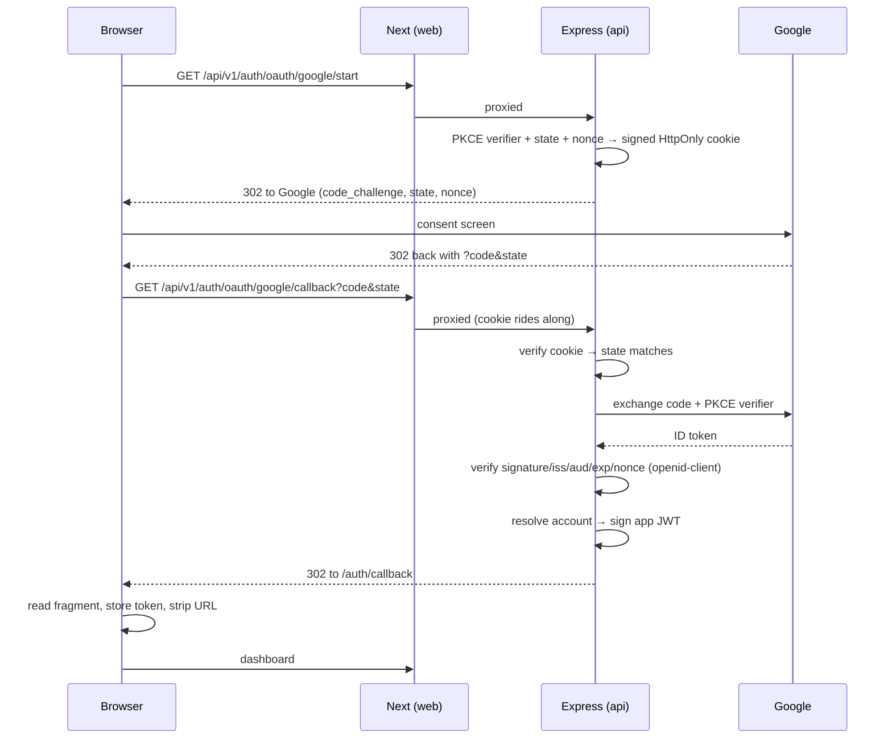

# Social sign-in setup (Google)

The app signs people in two ways:

| Method | Who it's for |
|---|---|
| **Google** (OAuth 2.0 + OIDC) | Shop owners signing up on their phone — no password to invent or forget |
| **Username + PIN** | Counter staff on a shared terminal, who need a two-second login and often have no Google account |

Social sign-in is **off until you configure it**. With no credentials set, `/auth/oauth/providers`
returns an empty list and the sign-in screen renders no Google button — nothing breaks.

---

## 1. Create the Google OAuth client

You need a Google account. This is free; no billing or verification is required for a
personal-scope app.

1. Open <https://console.cloud.google.com/projectcreate> and create a project (e.g. `shop-management`).
2. Go to **APIs & Services → OAuth consent screen**.
   - **Audience: External**, then **Create**.
   - Fill in app name, your support email, and developer contact email. Save.
   - Under **Data access**, add the scopes `openid`, `.../auth/userinfo.email`, and
     `.../auth/userinfo.profile`. These are non-sensitive, so no Google review is needed.
   - While the app is in **Testing**, only accounts you add under **Audience → Test users**
     can sign in. Click **Publish app** to open it to anyone.
3. Go to **APIs & Services → Credentials → Create credentials → OAuth client ID**.
   - **Application type: Web application**.
   - **Authorized JavaScript origins:** your web origin, e.g.
     `https://web-production-a1b81.up.railway.app` (and `http://localhost:3000` for local dev).
   - **Authorized redirect URIs:** the callback, which must match **byte for byte**:
     ```
     https://web-production-a1b81.up.railway.app/api/v1/auth/oauth/google/callback
     ```
     Add `http://localhost:3000/api/v1/auth/oauth/google/callback` too if you want it locally.
   - Create, then copy the **Client ID** and **Client secret**.

> The redirect URI points at the **web** origin, not the API's. The Next server
> reverse-proxies `/api/v1/*` to the API, which keeps the whole flow on one domain —
> the same single-origin setup that fixed the mobile DNS failures.

## 2. Set the variables

Local (`apps/api/.env`):

```bash
WEB_APP_URL=http://localhost:3000
GOOGLE_CLIENT_ID=<client id>
GOOGLE_CLIENT_SECRET=<client secret>
```

Railway — set them on the **api** service, then redeploy:

```bash
railway variables --service api --skip-deploys \
  --set "WEB_APP_URL=https://web-production-a1b81.up.railway.app" \
  --set "GOOGLE_CLIENT_ID=<client id>" \
  --set "GOOGLE_CLIENT_SECRET=<client secret>"
```

These are read at **request** time, not build time, so only the api service needs them
and a plain redeploy is enough.

## 3. Verify

```bash
curl -s https://web-production-a1b81.up.railway.app/api/v1/auth/oauth/providers
```

Expect `{"data":[{"id":"google","label":"Google"}]}`. The Google button then appears on
`/login` and `/register`. Click it, consent, and you land on the dashboard.

---

## How the flow works



### Account resolution

On each sign-in the API resolves the Google account in this order:

1. **Known identity** — a `user_identity` row already matches `(provider, provider_user_id)` → sign in as that user.
2. **Link by verified email** — the ID token carries `email_verified: true` **and** a user
   already holds that address in `app_user.verified_email` → attach the identity to that
   account. This is what lets a second provider join an existing account.
3. **New account** — otherwise create a new shop with the person as its `OWNER`.

**Both sides of that match must be trustworthy, not just the provider's.**
`app_user.email` is a plain contact field that any OWNER can set to an arbitrary string
through `POST/PATCH /shops/:shopId/users`, and anyone can become an OWNER via the public
`/auth/register`. If linking matched *that* column, an attacker could register a shop,
plant a stranger's address on a user inside it, and capture that person's first Google
sign-in straight into the attacker's shop. So linking matches only
`app_user.verified_email` — a separate column written **exclusively** by a
provider-verified sign-in, never from request input. Addresses are lower-cased before
matching so one mailbox cannot become two accounts. A deactivated user is refused.

### Security properties

- **Authorization Code + PKCE** (`S256`) — the code is useless without the verifier.
- **`state`** — blocks CSRF on the callback. **`nonce`** — binds the ID token to this request.
- All three live in a **signed, HttpOnly, SameSite=Lax** cookie scoped to `/api/v1/auth/oauth`,
  10-minute TTL, `Secure` in production. Stateless — no server-side session store.
- **ID token verification** (signature, issuer, audience, expiry, nonce) is done by
  [`openid-client`](https://github.com/panva/openid-client), an OpenID-certified library —
  not hand-rolled.
- The session token comes back in the **URL fragment**, which browsers never send to a
  server, so it stays out of access logs, proxies and the `Referer` header. The callback
  page strips it from the address bar immediately.
- The start endpoint is rate-limited (20 / 15 min / IP).

### Adding another provider

Any OIDC provider (Microsoft, Apple, …) is a new entry in `PROVIDER_CATALOG` in
[`apps/api/src/lib/oauthProviders.ts`](../apps/api/src/lib/oauthProviders.ts) plus its two
env vars — discovery supplies every endpoint. Add a brand mark to `ProviderMark` in
[`apps/web/src/components/SocialSignIn.tsx`](../apps/web/src/components/SocialSignIn.tsx).
GitHub is **not** a drop-in: it is plain OAuth2 with no ID token, so it would need its own
profile-fetch path.

## Troubleshooting

| Symptom | Cause |
|---|---|
| No Google button | Both `GOOGLE_CLIENT_ID` and `GOOGLE_CLIENT_SECRET` must be set; check `/api/v1/auth/oauth/providers`. |
| `redirect_uri_mismatch` from Google | The registered URI differs from `WEB_APP_URL` + `/api/v1/auth/oauth/google/callback` — including scheme and trailing slash. |
| `?error=session_expired` | The transaction cookie was missing or older than 10 minutes. Just retry. |
| `?error=access_denied` | The person declined consent at Google. |
| `?error=sign_in_failed` | Code exchange or ID-token verification failed — check the api service logs. |
| `403 access_denied` at Google | The app is still in **Testing** and the account isn't a listed test user. |
