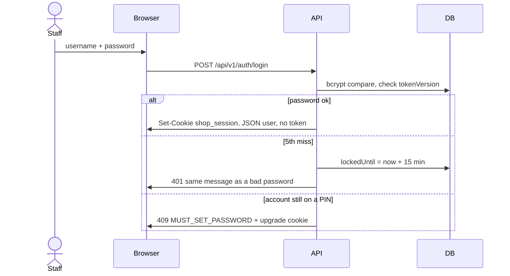
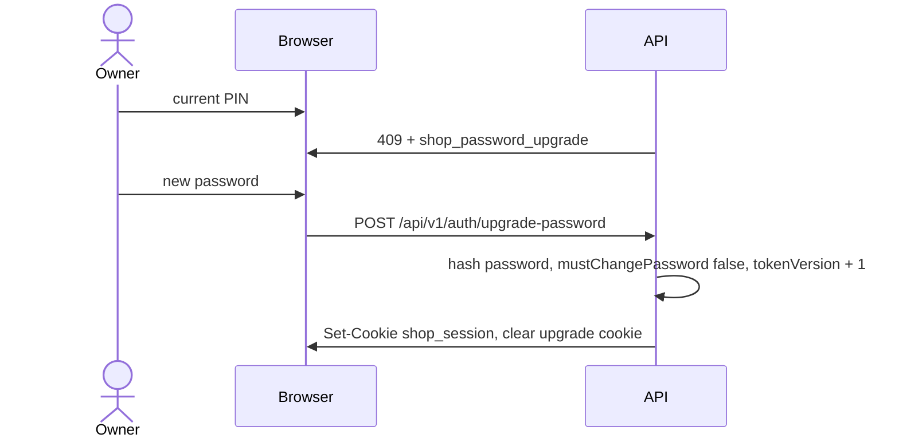

# Password sign-in

Created: 2026-11-20. Implementation starts: 2026-11-21, only after this doc is approved.

## Intent

The parts-counter login at `/login` asks for a 4–6 digit PIN. The hash is bcrypt (`apps/api/src/services/auth.ts`), but the secret is short, the screen says so, and the JWT sits in `localStorage` (`apps/web/src/lib/authToken.ts`). Logout does not revoke it (`apps/api/src/routes/auth.ts`). Replace the PIN with a username and a real password, and keep the session in an httpOnly cookie.

Staff may have no email. The username stays. There is no mailer, so there is no email reset.

## Goals

- Login and register accept a password, not a PIN.
- A 4-digit numeric secret cannot be a new password.
- The browser cannot read the session token.
- Logout and a password change kill that user's older tokens.
- Five bad passwords on one username pause that account.
- An existing PIN user can sign in once with the PIN only to set a password.
- Owner still creates staff (`requireRole('OWNER')` on `POST /shops/:shopId/users`). Owner types the staff password.

## Non-goals

- Email, magic links, 2FA, passkeys.
- Letting MANAGER create users. The route is owner-only today.
- Rewriting OAuth. It must end in the same cookie.

## Anti-goals

- A faster PIN on the counter. That keeps the hole.
- A second secret (password plus terminal PIN).

## Constraints

- Stack stays: Next.js web, Express API, Prisma, PostgreSQL, `bcryptjs`, `jsonwebtoken`, Zod in `@shop/shared`.
- Browser talks to the web origin. Next rewrites `/api/v1/*` to the API (`apps/web/next.config.ts`). Cookies ride that rewrite. Do not add cross-site cookies.
- Policy numbers live in one module, `packages/shared/src/authPolicy.ts`. No raw `10`, `5`, `15`, or `12h` at the call site.

## Approaches

| Approach | Pros | Cons |
|---|---|---|
| 1. Username + password, cookie session. **Chosen** (continue on 2026-11-20). | Uses the hash and roles that already exist. Closes the small PIN space and `localStorage`. | Counter typing is slower than 4 digits. |
| 2. Password once, then a PIN on that terminal. | Fast desk. | Two secrets. The PIN hole remains on a shared counter. |
| 3. Keep the PIN, only tighten the rate limit. | Tiny diff. | 10,000 guesses is still the secret. |

## Policy (`packages/shared/src/authPolicy.ts`)

| Name | Value | Why |
|---|---|---|
| `passwordMinimumLength` | 10 | Below this, guessing stays cheap. |
| `passwordRejectsDigitsOnly` | true | Blocks a PIN pasted into the password box. |
| `failedLoginLimit` | 5 | Per username, then lock. |
| `lockoutMinutes` | 15 | Window after the fifth miss. |
| `sessionTtl` | `12h` | Same length as `JWT_EXPIRES_IN` today. |
| `upgradeTtlMinutes` | 10 | How long the PIN-upgrade cookie lives. |
| `sessionCookieName` | `shop_session` | httpOnly session. |
| `upgradeCookieName` | `shop_password_upgrade` | Proves the PIN, not a session. |

Cookie flags match the OAuth cookies already in `apps/api/src/lib/oauthTransaction.ts`: `httpOnly`, `sameSite: 'lax'`, `secure` when `NODE_ENV === 'production'`, path `/`.

## Flows

PIN upgrade, one time:

While `lockedUntil` is in the future, login fails even if the password is correct. Lock message stays `Invalid username or password` for a miss and for a lock. A different lock sentence would tell an attacker the username is real. The counter sees the same sentence. The owner sets a new password, which clears `failedLoginCount`, `lockedUntil`, and bumps `tokenVersion`.

`mustChangePassword` is true for every existing user in the migration. Register and owner-created users with a password store false.

Logout (`POST /auth/logout`) increments `tokenVersion` and clears `shop_session`. A password change does the same. `authenticate` loads the user (it already does) and rejects the JWT when `tokenVersion` does not match. Inactive users stay rejected.

Login JSON no longer includes `token`. The web stops writing `localStorage` (`authToken.ts`). `fetch` uses `credentials: 'include'`. Calls stay on the web origin (the rewrite). A `Bearer` header is not a second browser session. Tests send the cookie.

OAuth's short `oauth_session` handoff sets `shop_session` and does not return a token for the page to store.

SameSite=Lax withholds the cookie on cross-site POST. Mutations stay POST. No CSRF token.

## Data

`User` gains:

- `tokenVersion Int @default(0)`
- `failedLoginCount Int @default(0)`
- `lockedUntil DateTime?`
- `mustChangePassword Boolean @default(false)`

Migration backfill: `mustChangePassword = true` where `password_hash` is not null. Those hashes are PINs.

A successful login clears `failedLoginCount` and `lockedUntil`. A miss increments the count and, at `failedLoginLimit`, sets `lockedUntil`. Unknown usernames still pay bcrypt against the throwaway hash (keep that timing trick) and do not create a row.

## API and screens

- `loginSchema` / `registerSchema`: `pin` becomes `password`, checked by the shared policy.
- `userCreateSchema` / `userUpdateSchema`: same swap. Owner sets or replaces a staff password. Replacing it bumps `tokenVersion`.
- `POST /auth/upgrade-password` body `{ password }`. Requires the upgrade cookie.
- Login page and register page: password field, `type=password`, no digit cap, no "4–6 digits" hint. After `409 MUST_SET_PASSWORD`, the login page shows "Choose a password".
- Staff dialog (`ShopUserFormDialog`) asks for a password, not a PIN. That same owner edit form is how anyone's password changes, including the owner's own row. No new settings page. Public "Create your shop" stays; it collects a password.
- Seed passwords come from the environment. Remove committed PIN literals from `apps/api/prisma/seed.ts`. Do not print the values.

## Tests

- Unit: policy rejects `1234` and `1234567890`, accepts 10+ chars with a letter. `tokenVersion` mismatch rejects. bcrypt still compares.
- Behavioural: login `Set-Cookie` and body has no `token`; logout cookie is gone and the old JWT 401s; fifth miss locks; sixth miss stays 401; upgrade cookie can set a password once; owner create with a password can log in.
- Smoke: `/login` shows Password, not PIN, and a sign-in posts `{ username, password }`.

## Files

- `packages/shared/src/authPolicy.ts` (new), `auth.ts`, `user.ts`, and their tests
- `apps/api/prisma/schema.prisma` plus one migration
- `apps/api/src/services/auth.ts`, `routes/auth.ts`, `routes/shops.ts`, `middleware/authenticate.ts`, seed, matching tests
- `apps/api/src/services/oauth.ts` and `routes/oauth.ts` only so the handoff sets `shop_session`
- `apps/web/src/lib/api.ts`, `authToken.ts` (delete the storage helpers once nothing imports them), `context/AuthContext.tsx`, `app/login/page.tsx`, `app/register/page.tsx`, `components/admin/shops/ShopUserFormDialog.tsx`

## Left to the builder

- Migration folder name and the exact Prisma field map.
- Order of commits, as long as each commit leaves login working for new passwords or still on the PIN upgrade path. Do not ship a build where old PIN users get a session and new passwords are rejected.
- Confirm in the smoke test that the Next rewrite forwards `Set-Cookie` to the browser. If it drops the cookie, stop. Do not fall back to `localStorage`.

## Calls made here

- Username stays; email is not the login id.
- Lock and bad password share one message.
- Owner-only staff create stays.
- Bearer is not kept for the browser.
- No email reset. A forgotten owner password needs a database reset until a mailer exists. `shortcut: no mailer, add email reset when the shop can receive mail.`
